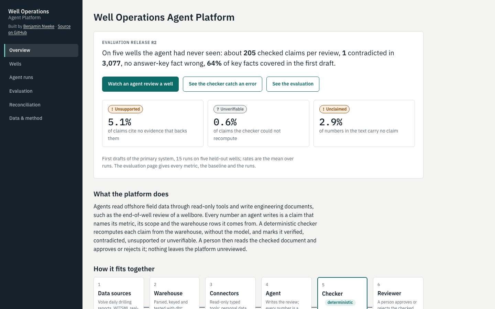
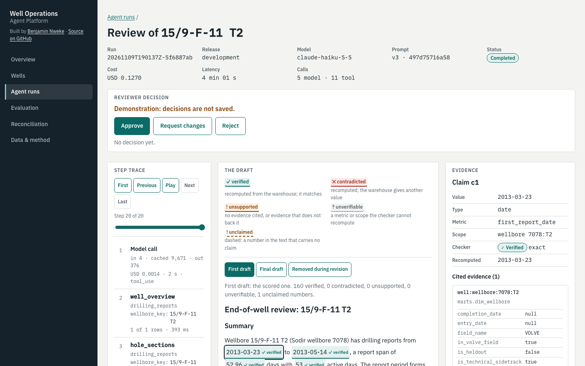
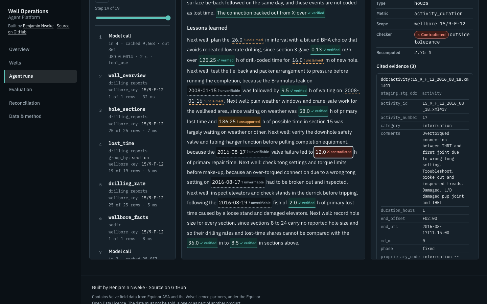
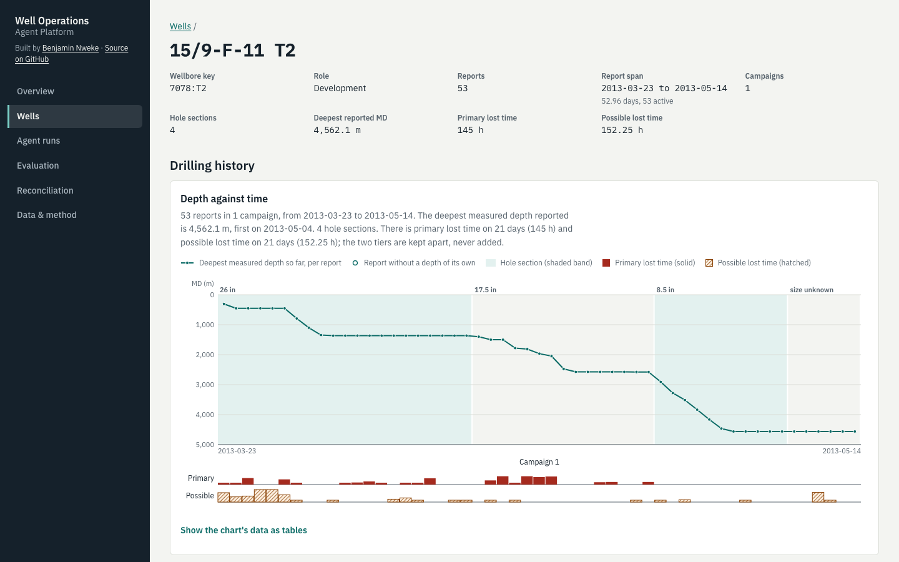

# Well Operations Agent Platform

Approval-gated agents that do engineering work on offshore field data: post-well reviews,
lost-time investigations and records reconciliation. Every claim an agent makes is checked against
the source data, and every run is recorded in an append-only audit log that can be replayed.

**Status: Phase 2: data platform**

## Console

A static web console shows the agents' work on the Volve data.



The overview: what the platform does and how the latest evaluation release scored.



The run viewer: an agent's review of 15/9-F-11 T2, every number marked by the checker, with the evidence for the selected claim.



The checker catching an error: a stated 12 h of repair time that the warehouse puts at 2.75 h.



The well view: depth against time with hole sections and lost time by day for 15/9-F-11 T2.

## Data sources

- **Volve field data**: Equinor ASA and the Volve licence partners, released under the
  Equinor Open Data Licence. The data may not be sold.
- **Sodir FactPages**: Norwegian Offshore Directorate, released under the Norwegian Licence for
  Open Government Data (NLOD) 2.0.
- **CIRA Centrifugal Pump Dataset** ([doi:10.5281/zenodo.18479728](https://doi.org/10.5281/zenodo.18479728)):
  released under CC BY 4.0.

The data is not stored in this repository. See [NOTICE](NOTICE) for full attribution.

## Development

Requires [uv](https://docs.astral.sh/uv/) and Python 3.12.

```sh
make setup   # install dependencies
make lint    # ruff and mypy
make test    # pytest
```

With the data downloaded into `data/raw/` (`make download`, `make download-volve`):

```sh
make rebuild   # parse data/raw/, then build and test the DuckDB warehouse with dbt
make quality   # write docs/data/data-quality-report.md
make console-data   # export the console's data bundle to console/public/data/ (ADR 0005)
```

The console needs Node.js 20.19 or later:

```sh
make console-dev          # serve the console locally
make console-check        # typecheck, lint, format check and tests
make console-screenshots  # rebuild the snapshots in docs/images/console/
```

See [docs/architecture.md](docs/architecture.md) for the layers and data flow, and
[docs/data/](docs/data/) for the data audit and data-quality reports.

## Licence

Code licensed under Apache-2.0; data licences in [NOTICE](NOTICE).
