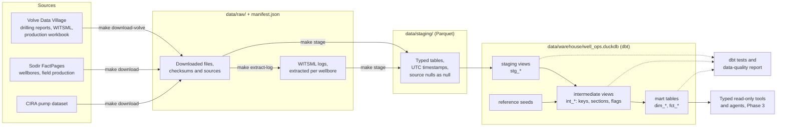

# Architecture

This page describes the layers of the platform and how data flows between them. The decisions
behind them are recorded in [ADR 0002](adr/0002-phase-2-data-decisions.md) (what the data means)
and [ADR 0003](adr/0003-warehouse-and-tooling.md) (how the warehouse is built).

## Data flow

## Layers

**Raw (`data/raw/`).** Files exactly as published, never edited. Every download is recorded in
`data/manifest.json` with its source URL and checksum. Real-time WITSML logs stay inside the
published zip until `make extract-log WELLBORE=<key>` extracts one wellbore's logs (ADR 0002 D6).
That command refuses held-out wellbores.

**Staging (`data/staging/`).** Python parsers in `src/well_ops/ingestion/`, one module per source,
read the raw files and write typed Parquet. They apply only rules that SQL cannot: decoding XML and
Excel, reading the source missing-value markers as null (ADR 0002 D3), and converting timestamps
to UTC with the original offset kept (D5). Personal fields (EDM user attributes, WITSML
`priv_*` elements) are never staged; their user names feed only the private redaction deny-list
(`data/private/`, never committed).

**Warehouse (`data/warehouse/well_ops.duckdb`).** A dbt project in `warehouse/` builds one DuckDB
file in four schemas:

- `staging`: one view per staged table, renaming, casting and converting units only.
- `intermediate`: wellbore keys and aliases (D1, D2), hole sections, data-quality flags (D4) and
  checks such as the daily production unit check (D9).
- `marts`: the tables later phases read, such as `dim_wellbore`, `dim_hole_section`,
  `fct_lost_time` and `fct_production_monthly_reconciliation`.
- `reference`: seeds such as the lost-time code tiers (D7).

Every model key is tested (`unique`, `not_null`, `relationships`, `accepted_values`), and a
failing test fails the build.

**Checks.** `make quality` writes [the data-quality report](data/data-quality-report.md) from the
built warehouse and the dbt results. It contains row counts, nulls by column, values read as null,
flag counts and test results, all as aggregates.

**Tools and agents (Phase 3).** Agents will read the marts through typed, read-only tools, one
connector per source, and never run free-form SQL.

## Tool conventions

Every connector tool (ADR 0004) follows these rules:

- **Deterministic output.** The same arguments on the same warehouse give byte-identical
  results. Tool output holds no random ids, timestamps or unordered sets, and every result is
  sorted. Run ids live only in the run audit log.
- **Structured errors.** Errors have the shape `{error, detail, hint}` and never echo the
  caller's input back.
- **Read-only.** Every tool is annotated read-only.
- **Dates explained.** Tool descriptions state what dates mean where it matters. For example,
  the Sodir completion date is the end of drilling, not production start-up, and drilling report
  dates are local time with the original offset kept.
- **Result envelope.** Every result lists its source relations, the resolved parameters, how
  many rows matched and were returned, whether the row cap applied, and how many values were
  redacted by type (never the redacted text).
- **Shared building blocks.** `well_ops.connectors.base` holds the server class, wellbore name
  resolution and the result envelope; `well_ops.connectors.evidence` builds and parses evidence
  ids, `well_ops.connectors.guard` refuses held-out wellbores outside evaluation mode, and
  `well_ops.connectors.redaction` redacts every text field before it leaves a server.
- **Held-out guard.** The guard blocks held-out keys exactly, not lettered sibling sidetracks of
  the same well. The guard protects development from tuning on held-out data; blocking siblings
  would remove a third of the development wellbores for negligible protection. In evaluation
  mode all wellbores are available.
- **Redaction.** The filter replaces email addresses, phone numbers, IP addresses and names on
  the private deny-list, which is built at staging from system user fields. No emails, phone
  numbers, IP addresses or deny-listed names were found in development activity comments. Names
  typed into free text but not present in system user fields cannot be detected by these
  patterns; they are covered by a manual spot check and by the agent rule never to name people.

## Commands

| Command | What it does |
|---|---|
| `make download`, `make download-volve` | Fetch the sources into `data/raw/` and record them in the manifest |
| `make extract-log WELLBORE=<key>` | Extract one development wellbore's real-time logs |
| `make stage` | Parse `data/raw/` into `data/staging/` |
| `make dbt-build` | Build and test the warehouse |
| `make rebuild` | Delete staging and the warehouse, then `make stage` and `make dbt-build` |
| `make quality` | Write the data-quality report |
| `make serve-ddr` | Run the drilling-report MCP server on stdio |

## Held-out wellbores

`evaluation/splits.json` lists the wellbores held out for evaluation (ADR 0002 D8). The warehouse
builds every wellbore, but reports, examples and tests use development wellbores or aggregates
only. Logs of held-out wellbores are not extracted.

## Continuous integration

CI runs ruff, mypy, pytest and `dbt compile` on every push. It holds no real data, so the
real-data rebuild and its tests run locally (`make rebuild`).
