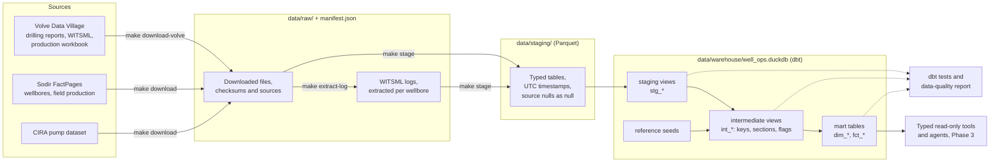

# Architecture

This page describes the layers of the platform and how data flows between them. The decisions
behind them are recorded in [ADR 0002](adr/0002-phase-2-data-decisions.md) (what the data means)
and [ADR 0003](adr/0003-warehouse-and-tooling.md) (how the warehouse is built).

## Data flow

## Layers

**Raw (`data/raw/`).** Files exactly as published, never edited. Every download is recorded in
`data/manifest.json` with its source URL and checksum. Real-time WITSML logs stay inside the
published zip until `make extract-log WELLBORE=<key>` extracts one wellbore's logs (ADR 0002 D6).
That command refuses held-out wellbores.

**Staging (`data/staging/`).** Python parsers in `src/well_ops/ingestion/`, one module per source,
read the raw files and write typed Parquet. They apply only rules that SQL cannot: decoding XML and
Excel, reading the source missing-value markers as null (ADR 0002 D3), and converting timestamps
to UTC with the original offset kept (D5). Personal fields in WITSML objects are never read.

**Warehouse (`data/warehouse/well_ops.duckdb`).** A dbt project in `warehouse/` builds one DuckDB
file in four schemas:

- `staging`: one view per staged table, renaming, casting and converting units only.
- `intermediate`: wellbore keys and aliases (D1, D2), hole sections, data-quality flags (D4) and
  checks such as the daily production unit check (D9).
- `marts`: the tables later phases read, such as `dim_wellbore`, `dim_hole_section`,
  `fct_lost_time` and `fct_production_monthly_reconciliation`.
- `reference`: seeds such as the lost-time code tiers (D7).

Every model key is tested (`unique`, `not_null`, `relationships`, `accepted_values`), and a
failing test fails the build.

**Checks.** `make quality` writes [the data-quality report](data/data-quality-report.md) from the
built warehouse and the dbt results. It contains row counts, nulls by column, values read as null,
flag counts and test results, all as aggregates.

**Tools and agents (Phase 3).** Agents will read the marts through typed, read-only tools, one
connector per source, and never run free-form SQL.

## Commands

| Command | What it does |
|---|---|
| `make download`, `make download-volve` | Fetch the sources into `data/raw/` and record them in the manifest |
| `make extract-log WELLBORE=<key>` | Extract one development wellbore's real-time logs |
| `make stage` | Parse `data/raw/` into `data/staging/` |
| `make dbt-build` | Build and test the warehouse |
| `make rebuild` | Delete staging and the warehouse, then `make stage` and `make dbt-build` |
| `make quality` | Write the data-quality report |

## Held-out wellbores

`evaluation/splits.json` lists the wellbores held out for evaluation (ADR 0002 D8). The warehouse
builds every wellbore, but reports, examples and tests use development wellbores or aggregates
only. Logs of held-out wellbores are not extracted.

## Continuous integration

CI runs ruff, mypy, pytest and `dbt compile` on every push. It holds no real data, so the
real-data rebuild and its tests run locally (`make rebuild`).
